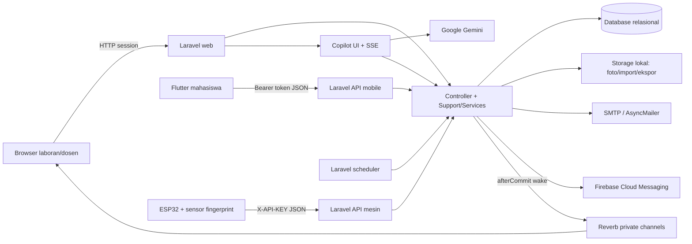

# Arsitektur Sistem SIMALAS

Pemetaan 2026-10-24. Dokumen ini menjelaskan hubungan yang ditemukan dari kode, bukan hasil pengujian runtime. Rincian alur dipisahkan ke `modules/` agar tidak menjadi sumber kebenaran ganda.

## 1. Gambaran dan batas komponen

SIMALAS adalah sistem absensi laboratorium berbasis fingerprint dengan portal staff, aplikasi mahasiswa, perangkat ESP32, pelaporan, PBL, komunikasi, dan asisten AI. Loker pernah ada dalam migration/kode historis, tetapi migration `2026_10_08_160000_drop_locker_schema_from_attendance.php` menghapus schema dan mesin loker dari lingkup absensi. Sisa teks/konstanta loker masih ditemukan; jangan menganggapnya bukti fitur loker aktif.

### Batas tanggung jawab

- **Web:** landing publik, autentikasi staff, dashboard, manajemen, rekap/laporan, PBL, komunikasi, dan Copilot. Entry route: `routes/web.php`.
- **Mobile API:** registrasi/login mahasiswa, profil, absensi sendiri, PBL, pengumuman/saran, push token. Entry route: `routes/api.php` prefix `/api/mobile`.
- **Machine API:** heartbeat, tap, resolve/enroll, dan sinkronisasi template. Entry route: `routes/api.php` prefix `/api/mesin`; autentikasi perangkat dengan hash API key dan ID mesin.
- **Flutter:** `simalas_mobile/lib/main.dart`, `api_config.dart`, screens/widgets. `main()` menginisialisasi lokalisasi/push lalu `SimalasApp`/`AppGate`; `ApiClient` memakai base URL yang dapat dioverride `--dart-define`.
- **Firmware:** `komunikasi-mesin/absensi/firmware/contoh-skeleton-minimal/` berisi sketch, UI, WiFi/NTP, dan offline queue LittleFS. Ini skeleton project; kesamaan dengan firmware perangkat fisik belum diverifikasi.
- **Data:** Eloquent models + migration historis. Migration memakai banyak pemeriksaan schema dan backfill; struktur aktual DB tetap perlu diverifikasi terpisah.
- **Generated/vendor:** `vendor/`, `node_modules/`, `public/build/`, cache, `public/downloads/`, dan artefak mobile bukan sumber yang dibaca untuk pemetaan ini.

## 2. Teknologi dan entry point

- `composer.json`: PHP `^8.3`, Laravel `^13.7`, Reverb, Tinker. Versi terpasang tidak diperiksa.
- `package.json`: Vite, React, Tailwind; UI operasional banyak memakai Blade dan JavaScript statis di `public/js`.
- `simalas_mobile/pubspec.yaml`: Flutter, HTTP, fl_chart, Firebase Messaging, shared_preferences, dan plugin platform.
- `bootstrap/app.php`: mendaftarkan route web/api/console/channel, health `/up`, middleware alias, scheduler, dan rendering exception.
- `public/index.php`: front controller web; API Laravel mengikuti front controller yang sama.
- `artisan`: command dan scheduler; jangan menjalankan command maintenance tanpa meninjau efeknya.

## 3. Role, autentikasi, dan otorisasi

| Role | Kanal utama | Mekanisme | Batas penting |
|---|---|---|---|
| Laboran | Web admin | Session Laravel setelah login | `role:laboran`, `approved`, permission menu CRUD |
| Dosen | Web dosen | Session Laravel | `role:dosen`, permission; scope mahasiswa/tim diterapkan oleh query/support |
| Mahasiswa | Flutter | Bearer token acak, SHA-256 di DB, idle expiry | Login hanya mahasiswa aktif/approved; data pribadi dibatasi `mobile_user` |
| Mesin | API ESP32 | `X-API-KEY` + ID mesin | API key diverifikasi dengan `Hash::check`, mesin aktif dan tipe route |

Middleware didaftarkan di `bootstrap/app.php`: `RoleMiddleware`, `PermissionMiddleware`, `EnsureAccountApproved`, `EnsureMobileToken`, dan `MesinApiAuth`.

`PermissionRegistry` menggabungkan default role dengan tabel `role_permissions`, di-cache 300 detik. Permission adalah lapisan menu/action; ia bukan satu-satunya batas data. Scope tambahan ada di `DosenMahasiswaScope`, `PblTeamService`, query `user_id` mobile, kepemilikan percakapan Copilot, dan kanal privat Reverb.

## 4. Peta data utama

- **Akun:** `users` berisi role, identitas akademik, status approval/aktivasi, keamanan login, relasi prodi, `finger_id`, template fingerprint, token mobile, serta kolom legacy `tim`/`shift`.
- **Absensi:** `log_absensi` = tap mentah; `absensi_harian` = status per user/tanggal/sesi dan tautan log masuk/pulang; `absensi_alfa`, `absensi_tidak_lengkap`, `absensi_komentar` = side record/koreksi; `tap_receipts` = keputusan idempoten berdasarkan `event_id`.
- **Aturan absensi:** `absensi_sesi_settings`, `absensi_kalender_libur`, `system_settings`, dan `AbsensiKebijakan`.
- **PBL:** `pbl_projects` menghubungkan manpro/co-manpro ke `users`; `pbl_team_members` menghubungkan mahasiswa dan peran ketua/wakil/anggota. `users.tim` masih dipakai sebagai representasi legacy.
- **Komunikasi:** `announcements` + `announcement_reads`, `suggestions`, `staff_ops_dismissals`, `mobile_push_tokens`.
- **AI:** `ai_conversations` → `ai_messages`; `ai_action_proposals` ada untuk rancangan HITL tetapi mode Copilot saat ini baca-saja.
- **Operasional:** `mesin_iot`, `fingerprint_sync_logs`, `account_approval_logs`, laporan dan setting.

Relasi penting diverifikasi dari model: `AbsensiHarian` memiliki `user`, `masukLog`, `pulangLog`, `koreksiOleh`; `PblProject` memiliki `manproUser`, `coManproUser`, `teamMembers`, dan relasi legacy `mahasiswa` melalui nama tim; `Announcement` memiliki `author` dan `reads`.

## 5. Indeks modul dan alur

- `modules/accounts-access.md`: registrasi/login/OTP, aktivasi/import, approval, permission, keamanan sesi.
- `modules/attendance-iot.md`: perangkat/fingerprint → tap → evaluator → status harian → koreksi → rekap/laporan/ekspor; scheduler dan Reverb.
- `modules/mobile-pbl-communication.md`: Flutter, token, PBL baru/legacy, pengumuman/saran/push.
- `modules/copilot.md`: UI → SSE → orchestrator → Gemini/tool → sumber data → blok UI; privasi dan batas akses.

### Alur inti ringkas

1. **Registrasi mandiri:** form web/mobile → buat user belum aktif + OTP di `email_verification_tokens` → `AsyncMailer` → verifikasi email → `PendingAccountApproval` → persetujuan laboran → akun aktif. Aktivasi akun import berbeda: kode sekali pakai → profil/password/email/HP → aktif tanpa approval tambahan.
2. **Absensi:** mesin memanggil `/api/mesin/tap` → `MesinApiAuth` → `AbsensiTapIdempotency` → `AbsensiTapEvaluator` → `log_absensi` + `absensi_harian` dalam transaksi → sinyal Reverb setelah commit → snapshot/rekap/laporan membaca hasil.
3. **Penutupan:** scheduler `absensi:close-sessions` dan cadangan `absensi:generate-alfa` → `AbsensiSessionCloser` → alfa tanpa tap setelah jam pulang dan tidak-lengkap setelah grace → koreksi staff memperbarui status dan side record.
4. **PBL:** admin/dosen/mobile ketua → `PblTeamService` → membership + sinkronisasi `users.tim`/`shift` → scope absensi dosen dan data mobile.
5. **Komunikasi:** pengumuman/saran → tabel komunikasi → audience/read state → feed web/mobile; observer pengumuman dapat memanggil FCM; OTP/status akun memakai email.
6. **Copilot:** pertanyaan → controller SSE → privasi/filter dan deklarasi tool sesuai role → Gemini function calling → tool database/adapter halaman → teks SSE dan blok stats/table/chart/link → simpan riwayat per user.

## 6. Aturan bisnis bersama

- `AbsensiTapEvaluator`: validasi akun/enroll/shift/hari/sesi; menentukan masuk/pulang, keterlambatan, lembur, status lengkap, dan resolusi side record.
- `AbsensiTapIdempotency`: receipt atomik, replay, payload hash, dan penanganan race untuk `event_id`. Jalur legacy tanpa `event_id` tetap tersedia tetapi tidak idempoten.
- `AbsensiSessionCloser` + `AbsensiKebijakan`: hari wajib, jam pulang, grace, cache penanda penutupan.
- `PeriodicReportBuilder`: agregasi periode dan ranking dari `absensi_harian`/`log_absensi`; dipakai halaman dan Copilot.
- `PblTeamService`: otorisasi manpro/co-manpro/ketua/laboran dan konsistensi membership.
- `AccountActivation`, `AccountEmailVerification`, `LoginSecurityService`: siklus akun dan perlindungan login.
- `AbsensiSnapshotSignals`: broadcast after-commit yang gagal-aman ke polling, tidak membatalkan tap.

## 7. Asynchronous, realtime, dan integrasi eksternal

- **Scheduler** di `bootstrap/app.php`: heartbeat tiap menit, close sessions tiap 15 menit, generate alfa harian, prune log fingerprint mingguan.
- **Queue:** migration jobs tersedia, tetapi tidak ada `app/Jobs` dalam inventaris. Reverb event memakai `ShouldBroadcastNow`; queue worker tidak dibutuhkan untuk jalur wake-up ini.
- **Email:** `AsyncMailer` memakai detached Artisan child pada Windows, terminating hook/fallback lain, dan retry SMTP pada non-Windows. Ini bukan queue database.
- **Reverb:** private `absensi.staff.laboran` dan `absensi.staff.dosen`; payload hanya wake metadata. Browser mengambil data melalui snapshot HTTP. Dok existing: `docs/REVERB-LOKAL.md`.
- **Gemini:** Copilot SSE `streamGenerateContent`; helpdesk publik menggunakan `generateContent` terpisah dengan FAQ fallback. Keduanya memakai konfigurasi `services.gemini`, tetapi alur privasi/tool berbeda.
- **FCM:** legacy server key atau HTTP v1/service account; `MobilePushService` dan `AnnouncementObserver`. Tidak ada credential yang dibaca.
- **reCAPTCHA/CAPTCHA:** web/mobile auth memakai helper terkait; DNS validation dapat dimatikan pada PHPUnit.
- **CDN:** Chart.js dimuat pada halaman tertentu; ketersediaan jaringan dapat memengaruhi visual, bukan sumber data.

## 8. Dummy versus data operasional

`DashboardDemoData::overlayAdmin/overlayDosen` mengganti KPI/grafik ketika `simalas.dashboard_demo` aktif; default konfigurasi `true` dapat dioverride environment tanpa membaca nilainya di sini. Controller menghitung data asli sebelum overlay. `overlayRekap` dan `overlayPeriodic` bersifat pass-through. Jangan menggeneralisasi dummy ke rekap, laporan, Copilot, mobile, atau seluruh dashboard.

## 9. Strategi pengujian

- `phpunit.xml`: SQLite memori, broadcast null, cache/session array, queue sync, mail array. Test feature yang ditemukan: import/aktivasi, Copilot, broadcast isolation, auth mesin, idempotensi tap.
- `CopilotStreamTest` menambahkan guard eksplisit SQLite `:memory:` dan provider palsu.
- `tests/Support/` juga berisi server palsu dan skrip integrasi/mutatif. `run_reverb_test.php` dan `run_reverb_failure_test.php` menargetkan MySQL `simalas_cleanup_test`, membaca konfigurasi lokal saat dijalankan, membuat/mengubah fixture, dan dapat menulis log. Mereka bukan test read-only dan tidak dijalankan.
- Tidak ada test/build yang dieksekusi pada pemetaan ini. Dokumentasi yang memuat hasil lama bukan bukti eksekusi baru.

## 10. Temuan awal dan ketidakpastian

1. `GenerateAbsensiAlfa` dan `GenerateAbsensiAlfaCommand` mendeklarasikan signature `absensi:generate-alfa` yang sama. Perlu verifikasi resolusi command; jangan menyimpulkan scheduler memilih salah satu tanpa bukti.
2. PBL menggunakan `pbl_team_members` sekaligus `users.tim`; kompatibilitas disengaja dalam kode, tetapi perubahan harus mempertahankan sinkronisasi dan menilai inkonsistensi data.
3. Migration menghapus loker, sedangkan `MachineAccessPolicy`, `Announcement`, dan `HelpdeskAiService` masih mengandung istilah loker. Ini sisa implementasi paralel/historis, bukan bug pasti tanpa kebutuhan runtime.
4. Komentar route `/api/mobile/logs` menyebut admin/dosen, sedangkan login mobile hanya mahasiswa dan controller tidak memeriksa role. Perlu konfirmasi kontrak yang diinginkan.
5. `AsyncMailer` mempunyai fallback yang menulis OTP dan email ke log aplikasi saat pengiriman gagal. Ini area sensitif untuk tinjauan keamanan; jangan membuka log aktual tanpa izin.
6. Firmware lama tanpa `event_id` tidak mendapat idempotensi. Dokumentasi firmware perlu dibandingkan dengan versi perangkat aktual.
7. Versi APK default di `config/mobile.php`, versi `pubspec.yaml`, dan override environment adalah sumber berbeda; kesesuaian rilis perlu diperiksa tanpa membaca rahasia.
8. Tidak semua controller, command debug/maintenance, skrip manual, dan UI ditelusuri. Dokumen ini bukan klaim memahami setiap baris project.
