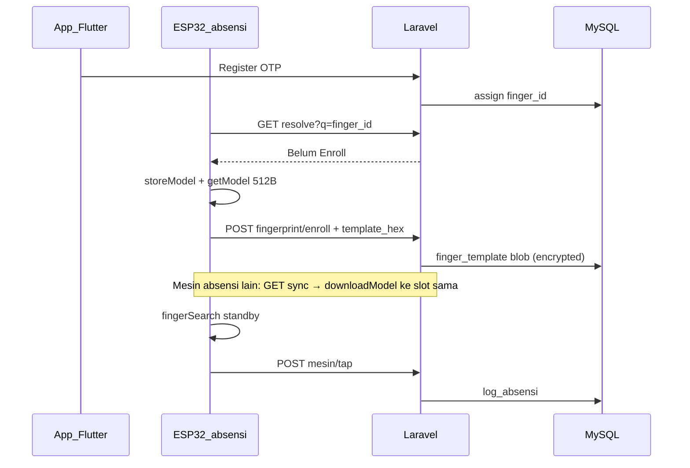

# Rencana integrasi — Mesin absensi (ESP32-S3 + DY50)

## Status implementasi (2026)

| Fitur | Status |
|-------|--------|
| `POST /mesin/tap` | Selesai — `AbsensiTapEvaluator` (shift, libur, jendela masuk/pulang) |
| Tap wajib enroll | Selesai — code `BELUM_ENROLL` jika tidak ada blob 512 byte valid |
| `GET /mesin/fingerprint/resolve` | Selesai — `q` = finger_id numerik |
| `GET /mesin/fingerprint/mahasiswa` | Selesai |
| `POST /mesin/fingerprint/enroll` | Selesai — wajib `template_hex` / `template_base64` (512 byte) |
| `GET /mesin/fingerprint/sync` | Selesai — pull template untuk mesin absensi |
| `GET /mesin/fingerprint/sync-status` | Selesai — delta ringan |
| `DELETE /mesin/fingerprint/{finger_id}` | Selesai — batalkan enroll DB |
| `GET|POST /mesin/heartbeat` | Selesai |
| Middleware `mesin.auth` | Selesai — auth terpusat |
| Firmware `contoh-skeleton-minimal.ino` | Selesai — enroll + upload template, auto-sync boot/5 menit |
| Enroll sekali → mesin absensi | Enroll di mesin absensi → DB → mesin absensi lain sync |
| Dosen absen sidik jari | **Tidak** (by design) |

## Keputusan arsitektur

| Topik | Implementasi |
|-------|----------------|
| finger_id | Otomatis saat registrasi OTP + backfill admin fingerprint |
| Enroll mesin | Ketik **finger_id** saja — harus sama dengan DB |
| Absen | STANDBY — tap jari terus tanpa pilih menu |
| Jadwal absensi | Menu **Atur Absensi** |
| Hapus 1 slot | Firmware `d` + `DELETE /mesin/fingerprint/{id}` |
| Kosongkan sensor | Menu `4` (sensor saja) + reset batch di admin jika perlu |

## Alur target

## Langkah tes demo

1. Admin: buat mesin absensi + salin **API key** & **id_mesin**
2. Sketch: set `API_BASE`, `API_KEY`, `ID_MESIN`
3. Serial `e` → finger_id → scan 2×
4. Standby: tempel jari → tap masuk/pulang
5. Cek admin log absensi + app mahasiswa (Sudah Enroll)
6. Tes tap sebelum enroll → harus `BELUM_ENROLL`

## Firmware resmi

Gunakan [`firmware/contoh-skeleton-minimal/contoh-skeleton-minimal.ino`](firmware/contoh-skeleton-minimal/contoh-skeleton-minimal.ino).
